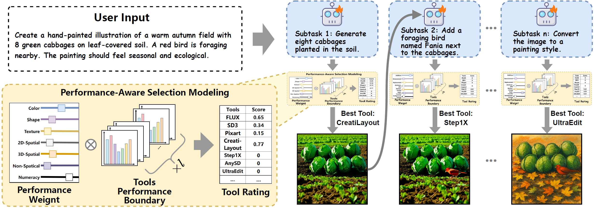

<h1 align="center">PerfGuard of ICLR2026</h1>

This is the official code for PerfGuard in ICLR 2026



## Benchmark Results

### T2I-CompBench

| Model | Color ↑ | Shape ↑ | Texture ↑ | Spatial ↑ | Non-Spatial ↑ | Complex ↑ |
|---|---:|---:|---:|---:|---:|---:|
| FLUX | 0.7407 | 0.5718 | 0.6922 | 0.2863 | 0.3127 | 0.3771 |
| SD3 | 0.8132 | 0.5885 | 0.7334 | 0.3200 | 0.3140 | 0.3703 |
| GoT | 0.4793 | 0.3668 | 0.4327 | 0.2238 | 0.3053 | 0.3255 |
| T2I-R1 | 0.8130 | 0.5852 | 0.7243 | 0.3378 | 0.3090 | 0.3993 |
| GenArtist | 0.8482 | 0.6948 | 0.7709 | 0.5437 | 0.3346 | 0.4499 |
| T2I-Copilot | 0.8039 | 0.6120 | 0.7604 | 0.3228 | 0.3379 | 0.3985 |
| PerfGuard (NVIDIA) | **0.8753** | 0.7366 | **0.8148** | **0.6120** | **0.3754** | **0.5007** |
| PerfGuard (Ascend 910B) | 0.8513 | **0.7570** | 0.7964 | 0.6052 | 0.3732 | 0.4976 |

### OneIG-Bench

| Method | Type | Alignment ↑ | Text ↑ | Reasoning ↑ | Style ↑ |
|---|---|---:|---:|---:|---:|
| FLUX | Diffusion | 0.786 | 0.523 | 0.253 | 0.368 |
| SD3 | Diffusion | 0.801 | 0.648 | 0.279 | 0.361 |
| GoT | CoT | 0.767 | 0.504 | 0.290 | 0.369 |
| T2I-R1 | CoT | 0.793 | 0.662 | 0.297 | 0.370 |
| GenArtist | Agent | 0.747 | 0.501 | 0.285 | 0.352 |
| T2I-Copilot | Agent | 0.821 | 0.679 | 0.318 | 0.386 |
| PerfGuard (NVIDIA) | Agent | 0.834 | **0.684** | **0.350** | **0.395** |
| PerfGuard (Ascend 910B) | Agent | **0.854** | 0.681 | 0.333 | 0.390 |

### Complex-Edit

| Method | IF ↑ | PQ ↑ | IP ↑ | O ↑ |
|---|---:|---:|---:|---:|
| AnySD | 4.13 | 7.14 | **9.08** | 6.78 |
| Step1X-Edit | 7.95 | 8.66 | 7.70 | 8.10 |
| GenArtist | 6.14 | 7.24 | 6.19 | 6.52 |
| OmniGen | 7.52 | 8.86 | 8.01 | 8.13 |
| PerfGuard (NVIDIA) | **8.95** | 9.02 | 8.56 | **8.84** |
| PerfGuard (Ascend 910B) | 8.78 | **9.15** | 8.37 | 8.77 |


## Environment Setup
1. Install Conda Environment
```shell
conda create -n PerfGuard python=3.10
conda activate PerfGuard
``` 

2. Install [MetaGPT](https://github.com/FoundationAgents/MetaGPT)

3. Please go to the following GitHub repository to install the necessary tool dependencies.
```shell
https://github.com/HaozheZhao/UltraEdit
https://github.com/HuiZhang0812/CreatiLayout
https://github.com/stepfun-ai/Step1X-Edit
https://github.com/weichow23/AnySD
https://github.com/bytedance/DreamO
https://github.com/Xiaojiu-z/EasyControl
https://github.com/tencent-ailab/IP-Adapter
```

4. Modify the relevant code to avoid environment conflicts.
```shell
# Insert the following code into './Step1X_Edit/inference.py'
import sys
sys.path.append("Step1X_Edit")
# Insert the following code into  './AnySD/anysd/src/model.py'
import sys
sys.path.append("AnySD")
```

5. Install the remaining dependencies
```shell
pip install -r nvidia_setting/requirement.txt
```

6. Download the planner checkpoint zip file and unzip it.
```shell
link: https://pan.baidu.com/s/1DyK9rZeTebdwAKfl_pl6DQ?pwd=ziy2 passward: ziy2 
```

7. Deploy LLM locally using vLLM
```shell
export VLLM_USE_MODELSCOPE=True 
vllm serve Qwen/Qwen3-14B   --port 8001
vllm serve your_planner_checkpoint  --port 8002
```

8. Modify the LLM config file under `./nvidia_setting/config`

## Run the program
```shell
cd nvidia_setting
python run.py
```

